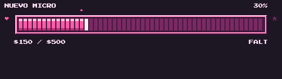
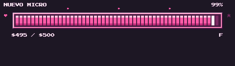
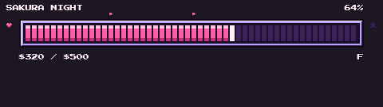
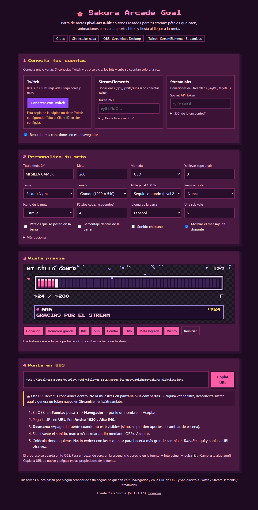
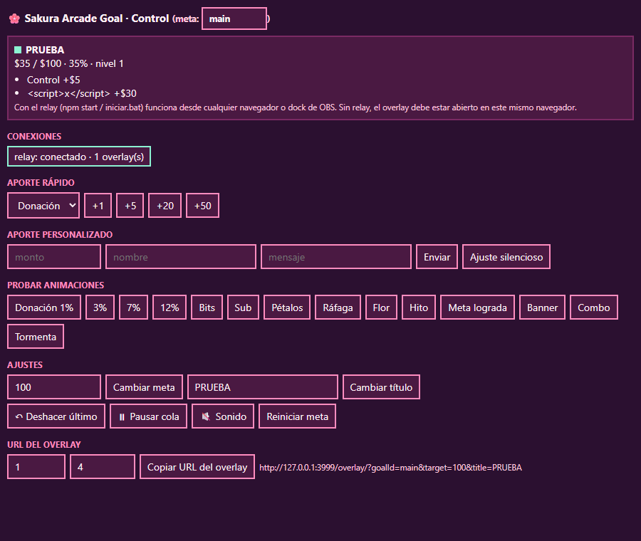
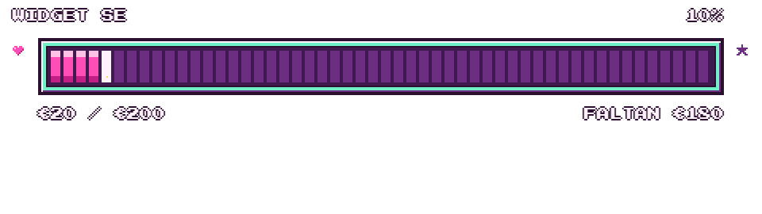
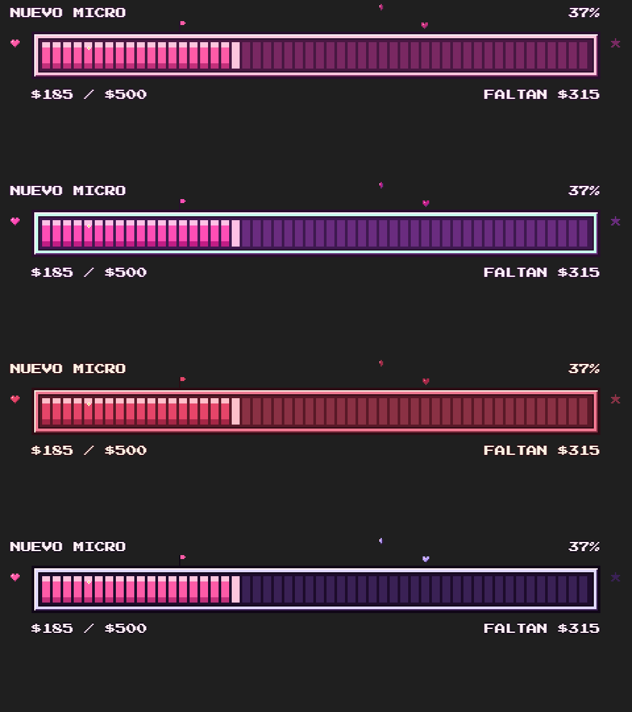

# 🌸 Sakura Arcade Goal — v1.2

Barra de metas **pixel-art 8-bit en tonos rosados** para Twitch / OBS: pétalos que caen, animaciones por tamaño de aporte, hitos con banderín y celebración al llegar a la meta.
Suma donaciones, bits y subs de **StreamElements, Streamlabs, Ko-fi y Twitch**, y se puede ajustar desde un panel o desde el chat.

| Donación grande | Meta lograda | Tema *Sakura Night* con pétalos que se posan |
|---|---|---|
|  |  |  |

## Efectos de cada aporte
El nivel depende de cuánto aporta respecto a la meta (pequeña < 2 %, mediana 2–5 %, grande 5–10 %, mega ≥ 10 %):

| Pequeña | Mediana | Grande | Mega |
|---|---|---|---|
| Cada bloque nuevo destella, explosión de pétalos, banner | + anillo de corazones y sacudida | + flor que florece en la punta, fuentes de pétalos desde las esquinas, 1 fuego artificial | + 5 fuegos artificiales con estela, barra arcoíris, **«¡MEGA APORTE!»** con onda y tormenta de pétalos |

Y cada tipo tiene su propio efecto, sonido y color:

| Donación | Bits | Sub | Subs regaladas | Raid / follow (si cuentan en la meta) |
|---|---|---|---|---|
| Monedas doradas que giran · dorado | Lluvia de gemas que chispean al tocar la barra (más bits, más gemas) · menta | Estrellas que orbitan la punta, «+SUB T2» · lavanda | Una caja de regalo por sub que cae y se abre · lavanda | Desfile de pétalos «RAID 80» / corazón «FOLLOW» |

Con  (o el ajuste de accesibilidad del sistema) se quitan la sacudida, el arcoíris y las fuentes, y hay menos fuegos y pétalos.

## ¿Qué versión uso?
| Quiero… | Usa | Necesita |
|---|---|---|
| **Lo más fácil**: entrar a una página, conectar mi cuenta y pegar una URL en OBS | **Versión web** (`dist/web/`, publicada en internet) | Nada (quien la publica: una cuenta gratis de GitHub) |
| Todo: donaciones de varios servicios, Ko-fi, Twitch, panel, comandos de chat, que nada se pierda si cierro OBS | **Relay** (`iniciar.bat`) | Node.js 20+, dejar una ventana abierta mientras transmites |
| Solo StreamElements, sin instalar nada | **Custom Widget de StreamElements** (`dist/streamelements-widget/`) | Cuenta de StreamElements |
| Probar o usar la barra a mano (teclado / panel), sin servidor | **Archivo único** (`dist/overlay.single.html`) | Nada |

---

## 0. Versión web pública (para cualquier persona)
Una página web donde el streamer conecta su cuenta, personaliza la barra con vista previa y copia una URL para OBS. **No instala nada ni deja nada abierto**: el propio navegador de OBS se conecta a Twitch, StreamElements y Streamlabs.



### Para quien la usa
1. Entra a la página (p. ej. `https://tunombre.github.io/sakura-goal/`).
2. **Conecta** Twitch con un clic y/o pega el token de StreamElements o Streamlabs (la página explica dónde está).
3. En **Tus barras** elige qué mide cada barra: 💰 donaciones, 💎 bits, ⭐ subs, 💜 seguidores o 🌸 todo junto. Puedes crear varias (p. ej. una de donaciones y otra de seguidores): cada una guarda sus ajustes en la página y **su propio progreso en OBS**. Ajusta título, meta, tema, tamaño… y prueba las animaciones en la vista previa.
4. **Copia la URL** de la barra elegida (una fuente de Navegador por barra si quieres varias a la vez) y en OBS: Fuentes → + → Navegador → pégala, con el ancho y alto que indica la página. Desmarca «Apagar la fuente cuando no esté visible».

Si un token deja de valer (el de Twitch dura unos 60 días), la barra lo avisa en su texto rotativo («RECONECTA TWITCH»): basta con volver a la página, reconectar y pegar la URL nueva en OBS.

### Para publicarla (una vez, gratis, sin programar)
1. Crea una cuenta en [github.com](https://github.com) y un repositorio **público** nuevo, por ejemplo `sakura-goal`.
2. En el repositorio: **Add file → Upload files** y arrastra **todo el contenido** de la carpeta `dist/web/` (no la carpeta, sus archivos: `index.html`, `overlay.html`, `app.js`, `site-config.js`, `licencias.txt`, `.nojekyll` y la carpeta `fonts`). *Commit changes*.
   El archivo `.nojekyll` está oculto en Windows: actívalo en el Explorador con *Vista → Mostrar → Elementos ocultos*. Si no lo subes, todo funciona igual.
3. **Settings → Pages** → *Source: Deploy from a branch* → rama `main`, carpeta `/ (root)` → *Save*. En 1–2 minutos la página está en `https://TU-USUARIO.github.io/sakura-goal/`.
4. **Twitch (opcional pero recomendado):** en [dev.twitch.tv/console/apps](https://dev.twitch.tv/console/apps) → *Register Your Application*: nombre libre, **OAuth Redirect URL = la dirección exacta del paso 3** (con la `/` final), categoría *Broadcaster Suite*, cliente **Público** → *Create* → copia el **Client ID**.
   En GitHub abre `site-config.js` → lápiz (editar) → pon el Client ID entre las comillas de `twitchClientId: ''` → *Commit changes*. El Client ID no es secreto: una sola app sirve para todos los que usen tu página.
5. Para actualizarla más adelante: `npm run build` y vuelve a subir los archivos de `dist/web/` (sin pisar tu `site-config.js`).

### Qué queda dónde (privacidad)
- Los tokens van en la parte `#` de la URL de OBS: **el navegador nunca envía esa parte al servidor** que aloja la página (GitHub no la ve; hay un test que lo comprueba). La página tampoco tiene servidor propio ni analíticas.
- El progreso de la meta se guarda en el navegador interno de OBS de cada streamer.
- Límites frente al relay: sin Ko-fi (necesita un servidor que reciba sus avisos) ni comandos de chat; y la URL de OBS **no debe mostrarse en pantalla** porque lleva los tokens.

## 1. Relay (modo avanzado)
1. Instala **Node.js 20 o superior** (versión LTS) desde https://nodejs.org.
2. Doble clic en **`iniciar.bat`** (Windows) o **`iniciar.command`** (macOS; la primera vez: clic derecho → Abrir). La primera vez instala lo necesario y crea el archivo `.env`.
3. Abre `.env` con el Bloc de notas, pon los tokens de lo que uses (tabla de abajo), guarda, cierra la ventana negra y vuelve a abrir `iniciar.bat`.
4. La ventana muestra la URL del overlay (`http://127.0.0.1:3000/overlay/`) y el estado de cada conexión. Si el puerto 3000 está ocupado usa el siguiente y lo avisa.

**Abre el relay antes que OBS** y déjalo abierto mientras transmites. Para que arranque solo: `Win+R` → `shell:startup` → crea ahí un acceso directo a `iniciar.bat`.
Si OBS se abre primero no pasa nada: el overlay muestra su último estado y se conecta en cuanto el relay arranca. Lo que llegue con OBS cerrado se suma al volver, sin repetir celebraciones.

### Tokens (`.env`)
| Servicio | Variable | Dónde sacarlo |
|---|---|---|
| StreamElements | `STREAMELEMENTS_JWT` | Dashboard → tu avatar → Account → Channels → *Show secrets* → JWT Token |
| Streamlabs | `STREAMLABS_SOCKET_TOKEN` | Dashboard → Settings → API Settings → API Tokens → *Your Socket API Token* |
| Ko-fi | `KOFI_VERIFICATION_TOKEN` | ko-fi.com → Settings → More → API → Webhooks → *Verification Token* (ver §1.2) |
| Twitch | `TWITCH_CLIENT_ID` | Tu app en dev.twitch.tv; luego panel → **Conectar Twitch** (ver §1.3) |

Los tokens viven solo en `.env` (y `twitch-token.json`), nunca en la URL del overlay, y en los logs salen como `***`.
Si conectas varios servicios, **bits y subs se cuentan desde uno solo** (por defecto Twitch si está conectado, si no StreamElements, si no Streamlabs; cámbialo con `BITS_FROM` / `SUBS_FROM`). Las donaciones de cada servicio sí se suman todas: son pagos distintos.

### 1.1 OBS
1. Fuentes → **+ → Navegador** → URL `http://127.0.0.1:3000/overlay/?target=500&title=NUEVO%20MICROFONO`
2. Ancho **960** × alto **270** (para `scale=1`; con `scale=2` usa 1920 × 540, etc.). Marca *Usar velocidad de fotogramas personalizada*: 30 o 60.
3. **Desmarca** "Apagar la fuente cuando no está visible". No pegues CSS personalizado.
4. Sonido (opcional, `&sound=1`): marca "Controlar audio mediante OBS".
5. Panel de control como dock (opcional): Docks → Docks de navegador personalizados → `http://127.0.0.1:3000/control/`.

### 1.2 Ko-fi
Ko-fi avisa de cada donación llamando a una URL **pública con HTTPS**, así que hace falta un túnel desde internet hasta tu PC.
Con `KOFI_VERIFICATION_TOKEN` puesto, el relay abre un **segundo puerto (`KOFI_PORT`, 3001) que solo atiende el webhook**: el túnel apunta ahí y ni el panel, ni la API, ni el overlay quedan expuestos. Si por error apuntas el túnel al puerto 3000, el relay detecta las cabeceras del proxy y también bloquea todo menos el webhook.
1. Instala [cloudflared](https://developers.cloudflare.com/cloudflare-one/connections/connect-networks/downloads/) y ejecuta `cloudflared tunnel --url http://127.0.0.1:3001`. Te da una dirección tipo `https://algo-al-azar.trycloudflare.com`.
2. En Ko-fi → Webhooks pega `https://algo-al-azar.trycloudflare.com/webhook/kofi` y copia el *Verification Token* a `.env`. Reinicia el relay.
3. Pulsa **Send Test** en Ko-fi: el panel debe mostrar `kofi: conectado` y el overlay anima la prueba **sin sumarla**.

La dirección rápida de cloudflared **cambia cada vez**; para no actualizar Ko-fi en cada stream usa un túnel con nombre de Cloudflare o un dominio fijo de ngrok (`ngrok http 3001 --url=tu-dominio.ngrok-free.app`).
Suman `Donation` y `Subscription` (`KOFI_TYPES` admite también `shop order` y `commission`). Las donaciones privadas salen como "ANÓNIMO" y sin mensaje. Los reintentos de Ko-fi no suman dos veces.

### 1.3 Twitch (bits, subs, regalos, seguidores, raids)
1. En [dev.twitch.tv/console/apps](https://dev.twitch.tv/console/apps) → *Register Your Application*: categoría *Broadcaster Suite*, cliente **Público**, OAuth Redirect URL **`http://localhost:3000/control/twitch.html`** (con el puerto de tu relay).
2. Pon el *Client ID* en `.env` (`TWITCH_CLIENT_ID=`) y reinicia el relay.
3. Panel → **Conectar Twitch (bits y subs)** → *Conectar con Twitch* → autoriza. Solo pide permisos de lectura.

El token dura unos 60 días; el relay avisa cuando falta poco y basta con volver a pulsar Conectar. 5 subs regaladas cuentan como 5 subs, a nombre de quien regala.

### 1.4 Comandos de chat
Pon `CHAT_COMMANDS=1` en `.env`. El relay lee tu chat **de forma anónima** (no necesita token ni escribe nada). Por defecto solo tú y tus moderadores pueden usarlos (`CHAT_ALLOW=mods`, o `broadcaster` / `vips`).

| Comando | Qué hace |
|---|---|
| `!meta add 5 [nombre]` | Suma 5 con animación (p. ej. una donación en efectivo). Sin nombre se acredita a quien escribe |
| `!meta quitar 5` | Resta 5 sin celebrar (reembolsos, errores) |
| `!meta set 600` | Cambia la meta a 600 |
| `!meta titulo NUEVA SILLA` | Cambia el título |
| `!meta deshacer` | Revierte el último aporte |
| `!meta celebrar` | Lanza la animación de meta lograda |
| `!meta reset` | Vuelve a 0 (**solo el streamer**) |

El canal es el de la cuenta conectada en "Conectar Twitch", o el que pongas en `TWITCH_CHANNEL`. El prefijo se cambia con `CHAT_PREFIX`.

### 1.5 Panel de control (`/control/`)
Aportes rápidos y personalizados, ajuste silencioso (admite negativos), prueba de cada animación, cambiar meta y título, deshacer, pausar la cola, sonido, reiniciar y **copiar la URL del overlay**. La sección *Conexiones* muestra el relay, los overlays abiertos y el estado de cada servicio.



---

## 2. Custom Widget de StreamElements (sin instalar nada)
1. StreamElements → *Streaming tools* → *Overlays* → nuevo overlay → **+ Add widget → Static / Custom → Custom widget** → *Open editor*.
2. Pega cada archivo de `dist/streamelements-widget/` en su pestaña: `widget.html` → **HTML**, `widget.css` → **CSS**, `widget.js` → **JS**, `fields.json` → **FIELDS**. Guarda.
3. En la columna izquierda del editor aparecen los ajustes: meta, título, tema, escala, pétalos, sonido, valores de bits y subs… y botones para **probar** cada animación, deshacer y reiniciar.
4. Dale al widget el tamaño de la escala elegida (960 × 270 en escala 1) y añade el overlay a OBS como siempre.

El progreso se guarda en tu cuenta de StreamElements, así que sobrevive a recargas. Para varias barras distintas, cambia el campo *ID de la meta* en cada una.
Los eventos "emulados" del editor se animan pero no suman (actívalo con *Sumar los eventos de prueba*).
Este modo solo recibe lo que pasa por StreamElements: para Ko-fi, Twitch directo, Streamlabs o comandos de chat usa el relay.



## 3. Archivo único (sin servidor)
`dist/overlay.single.html` lleva todo dentro (estilos, código y fuente). En OBS: fuente Navegador → marca **Archivo local** → elige el archivo, y añade los parámetros en la URL si quieres (`…overlay.single.html?target=500&title=MI%20META`).
Se maneja con el teclado en una ventana de navegador con `?debug=1` (o desde el panel abierto en el **mismo** navegador). Guarda el progreso en el navegador de OBS.

---

## 4. Personalizar
Todo se configura con parámetros en la URL (el panel la genera). Los más usados:

| Parámetro | Ejemplo | Qué hace |
|---|---|---|
| `title`, `target` | `title=NUEVO%20MICRO&target=500` | Título (máx. 24) y meta |
| `goalType` | `mix` · `donations` · `bits` · `subs` · `follows` | **Qué mide la barra**: todo junto en dinero (por defecto), solo donaciones, bits, subs (1 por sub, 5 regaladas = 5) o seguidores. Usa un `goalId` distinto por barra para que cada una guarde su progreso |
| `goals` | `goals=MICRO:500,CAMARA:1000` | **Metas encadenadas**: al completar una pasa a la siguiente con el sobrante |
| `onComplete` | `overflow` · `hold` · `next-goal` · `reset` | Al llegar al 100 %: seguir contando en una barra dorada (nivel 2…), quedarse llena, siguiente meta o volver a 0 |
| `theme` | `sakura` · `bubblegum` · `strawberry` · `sakura-night` | Tema de colores |
| `scale` | `1`–`4` | Tamaño (siempre entero, para que los píxeles sean cuadrados) |
| `goalIcon` | `star` · `gift` · `trophy` · `heart` | Ícono de la meta (se desbloquea al 100 %) |
| `petalIntervalSec`, `petalLanding` | `petalIntervalSec=6&petalLanding=1` | Cada cuántos segundos caen pétalos; pétalos que se posan en la barra |
| `unit`, `currency` | `unit=bits` · `currency=EUR` | Qué mide la barra y en qué moneda |
| `bitsRate`, `subRates`, `rates` | `subRates={"T1":4}` · `rates={"USD":1,"EUR":1.08}` | Cuánto vale cada bit, sub o moneda extranjera (**ajústalo a tu caso**) |
| `milestones` | `milestones=20,40,60,80` | Hitos con banderín |
| `sound`, `volume` | `sound=1&volume=0.1` | Sonido chiptune |
| `retroFps` | `30` · `15` | Dibujo más retro y menos consumo |
| `resetEvery` | `daily` · `weekly` · `monthly` | Meta diaria, semanal (desde el lunes) o mensual: vuelve a 0 sola, en tu hora local |
| `tickerMessages` | `tickerMessages=last,¡GRACIAS!,remaining` | Qué rota bajo la barra: `last` (último aporte), `top` (mayor donante), `remaining` (lo que falta) o textos tuyos (máx. 27 letras) |
| `showPercentInBar` | `showPercentInBar=1` | Porcentaje también dentro de la barra |
| `leftIcon` | `heart` · `star` · `gift` · `trophy` · `gem` · `flower` | Ícono del extremo izquierdo |
| `goalId` | `goalId=suscriptores` | Varias barras independientes a la vez (cada una con su URL y su progreso) |
| `lang` | `en` | Textos en inglés |



Lista completa: sección 7 del plan y `overlay/js/config.js`.

## 5. Preguntas frecuentes y problemas
- **La barra no se mueve con las donaciones.** Mira la ventana del relay y la sección *Conexiones* del panel. `error: token rechazado` → revisa el token en `.env`. Si todo dice `conectado`, haz una prueba desde el dashboard del servicio. Las pruebas se animan pero **no suman** salvo `countTestEvents=1`.
- **Se sumó algo dos veces.** No debería: cada evento tiene un id y se descarta si se repite. Si conectaste Twitch y StreamElements a la vez, bits y subs se toman de uno solo. Si aun así pasa, usa *Deshacer* y revisa `payloads.jsonl` (ver el último punto).
- **Una donación en otra moneda no suma.** Añade su tasa: `rates={"USD":1,"EUR":1.08,"CLP":0.001}` (cuánto vale 1 unidad de esa moneda en la moneda de tu meta). No se consultan tasas por internet a propósito.
- **Cambié de escena y se perdieron aportes.** Desmarca "Apagar la fuente cuando no está visible". Con el relay igualmente se recuperan al volver.
- **El texto se ve borroso.** Usa `scale` entero y el tamaño exacto en OBS (960 × 270 por cada unidad de escala). No escales la fuente en la escena con el ratón; cambia `scale`.
- **No suena.** `sound=1` y en OBS "Controlar audio mediante OBS". En un navegador normal hay que hacer clic una vez en la página (bloqueo de autoplay).
- **El puerto 3000 está ocupado.** El relay usa el siguiente y lo dice; copia la URL que muestra. Para fijarlo, cambia `PORT` en `.env`.
- **Va lento en mi PC.** `retroFps=30`, `petalMax=12`, sin `petalLanding`. En OBS → Ajustes → Avanzado activa la aceleración por hardware del navegador. Medido en Chrome: ~2 % del hilo principal en reposo, ~4 % con el efecto más grande, 60 fps sostenidos.
- **Quiero mover/cambiar la meta en directo.** Panel de control, comandos de chat o la API local (abajo).
- **Algo raro con un servicio.** Pon `SAVE_PAYLOADS=1` en `.env`: el relay guarda los eventos tal como llegan en `payloads.jsonl`. Con eso se ajusta `relay/normalize.js` en minutos.

## 6. API local (Streamer.bot, Touch Portal, curl…)
Solo acepta peticiones del propio PC y de páginas servidas en `localhost`.
```
curl -X POST http://127.0.0.1:3000/api/event -H "Content-Type: application/json" -d "{\"kind\":\"donation\",\"rawAmount\":5,\"name\":\"Ana\",\"message\":\"hola\"}"
curl -X POST http://127.0.0.1:3000/api/cmd   -H "Content-Type: application/json" -d "{\"cmd\":\"key\",\"key\":\"c\"}"
curl http://127.0.0.1:3000/api/health
curl "http://127.0.0.1:3000/api/state?goalId=main"
```
`kind`: `donation`, `bits`, `sub`, `giftsub`, `follow`, `raid`, `adjust` (corrige sin celebrar). Sin `rawCurrency` se usa la moneda de la meta.
`cmd`: `key` (teclas del modo debug), `reset`, `undo`, `target`, `title`, `pause`, `sound`.

---

## 7. Desarrollo
```
npm install      # dependencias + vitest
npm test         # 81 tests de lógica, relay y conectores (rápidos)
npm run test:visual  # 15 tests en Chrome real: overlay (plan §11.2) y página web pública
npm start        # relay en http://127.0.0.1:3000
npm run build    # genera dist/ (versión web, archivo único y widget de StreamElements)
```
Overlay de prueba: `http://127.0.0.1:3000/overlay/?debug=1` · teclas `1-4` donación por nivel · `B` bits · `S` sub · `P` pétalos · `W` viento · `M` siguiente hito · `C` meta lograda · `F` flor · `T` tormenta · `N` banner · `X` combo · `Z` deshacer · `R` reiniciar.
`dist/` se genera desde `overlay/`: edita siempre `overlay/` y vuelve a ejecutar `npm run build`.
`test:visual` usa el Chrome o Edge que tengas instalado (no descarga navegadores) y deja capturas en `test/visual/capturas/` para revisarlas a ojo.

```
StreamElements ─┐ socket.io + JWT           ┌─ relay (Node, 127.0.0.1) ─────────────┐   WebSocket /ws   ┌─ overlay (OBS) ─┐
Streamlabs ─────┤ socket.io + token         │ normaliza → dedupe por id → filtro de │ ────────────────► │ convierte, anima │
Twitch ─────────┤ EventSub + chat anónimo ► │ fuente → log → state.json (atómico)   │ ◄── estado ─────── │ y reduce         │
Ko-fi ── túnel ─┤ POST :3001 (solo webhook) └───────────────────────────────────────┘                   └──────────────────┘
Panel / REST ───┘
```
- El overlay convierte unidades y aplica el reducer puro (`overlay/js/state.js`), así su config por URL manda. Tras cada cambio devuelve el estado al relay, que lo guarda en `state.json` (escritura atómica, debounce 200 ms).
- Al conectar, el relay entrega un *snapshot* más los eventos que llegaron con el overlay apagado; esos se suman sin animar.
- Dedupe en dos niveles (relay por id de evento y overlay por `seenIds`). Reconexión exponencial con jitter en todos los conectores.
- Los builds de `dist/` usan un empaquetador mínimo propio (`scripts/build.js`): cada módulo se envuelve en una función. Si algún día se usa un patrón de módulo que no entiende, el build falla con un mensaje en vez de generar algo roto.

```
relay/      server.js · hub.js · store.js · normalize.js · routes.js · log.js · env.js
            connectors/ streamelements · streamlabs · kofi · twitch-eventsub · twitch-chat
overlay/    index.html · css/ · js/ (main, config, state, events, director, sprites, audio, i18n)
            js/sources/ relay · se-widget · direct   js/hosts/ streamelements · direct
web/        página pública de configuración (index.html · app.js · site-config.js)
control/    index.html · control.js · twitch.html
scripts/    build.js
test/       core · relay · phase4 · phase5 · web (+ fixtures de cada servicio) · visual/ (Chrome real)
```

## 8. Estado y pendientes de verificar
Hecho: las 5 fases del plan (sección 10), todos los parámetros de la sección 7 y los tests automáticos de la sección 11 (lógica y visuales).
Verificado en Chrome real: animaciones, temas, metas encadenadas, persistencia, panel por relay, archivo único por `file://`, widget de SE con una API simulada, 60 fps con el efecto mega. Verificado contra servicios reales: conexión a StreamElements, Streamlabs, `id.twitch.tv` y el chat de Twitch (con tokens falsos o en modo anónimo).

**Falta probar con tus cuentas** (formas de los datos tomadas de la documentación, no de eventos reales):
- Bits/subs/regalos de StreamElements y Streamlabs, y los nombres de campo de regalos en el widget de SE (`bulkGifted`, `isCommunityGift`).
- Login de Twitch y eventos reales de EventSub; Ko-fi a través de un túnel real y que su "Send Test" use el id ficticio `00000000-1111-2222-3333-444444444444`.
- En tu OBS: transparencia, fuente, sonido y si el dock comparte navegador con el Browser Source.

Hallazgos del plan (§12): Press Start 2P trae `ñ á é í ó ú ü ¡ ¿` pero no `♥`/`★` (los íconos son sprites, `*` reemplaza palabras bloqueadas) · socket.io v4 sirve para StreamElements y Streamlabs · Ko-fi por túnel a un puerto solo-webhook · una sola fuente para bits/subs · el navegador escribe `WebSocket connection … failed` en consola mientras el relay está cerrado; es un aviso del propio navegador y el overlay sigue funcionando.
Desviaciones del plan: `node:http` + `ws` en vez de fastify y validación propia en vez de zod/pino (menos dependencias); el Modo A "directo" a StreamElements quedó cubierto por el Custom Widget, que no expone el token en ninguna URL.

## Licencias
Fuente *Press Start 2P* © CodeMan38, SIL Open Font License 1.1 (`overlay/assets/fonts/OFL-LICENSE.txt`).
